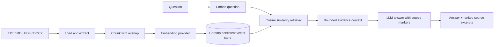

# Atlas RAG

**A practical, inspectable retrieval-augmented generation system.** Upload your notes, retrieve relevant passages, and ask grounded questions with source citations. The project is designed to be understandable enough to study and structured enough to extend.

  

## What it does

- Ingest `.txt`, `.md`, `.pdf`, and `.docx` files, with safe size/type checks and content-hash IDs.
- Extract text, split it into bounded overlapping chunks, embed it, and persist vectors in Chroma.
- Search semantically and return ranked passages with document, page, and similarity metadata.
- Generate answers grounded in retrieved evidence and cite source markers such as `[S1]`.
- Run embeddings locally on CPU by default; optionally use OpenAI embeddings and generation.
- Inspect API contracts in interactive Swagger UI at `/docs`.

## Architecture



### Request lifecycle

1. **Ingestion** — The API validates the extension and 25 MB limit, extracts page-aware text, normalizes and chunks it, computes a SHA-256 document ID, embeds in batches, then upserts stable chunk IDs and metadata.
2. **Retrieval** — A question is embedded using the same configured provider and searched in Chroma's cosine space. The service returns up to `top_k` passages, including a similarity score (`1 - cosine distance`).
3. **Generation** — Retrieved excerpts are placed in a bounded context. The system prompt treats document text as untrusted input, asks for evidence-only answers, and requires citations. An unconfigured LLM fails clearly; ingestion and retrieval remain independently usable.

The code is separated by responsibility: `loaders`, `chunking`, `embeddings`, `vector_store`, `ingestion`, `retrieval`, `generation`, and `api`. The evaluation script reports retrieval Recall@k and mean reciprocal rank (MRR) against a small labeled JSONL dataset.

## Quick start

Requires Python 3.11 or newer. Local embeddings download a model on first use and may take a few minutes. Answer generation requires an OpenAI API key.

```powershell
cd atlas-rag
py -3.11 -m venv .venv
.\.venv\Scripts\Activate.ps1
python -m pip install -e ".[dev]"
Copy-Item .env.example .env
```

Add `OPENAI_API_KEY` to `.env` to enable generation. Then launch:

```powershell
uvicorn atlas_rag.api:app --reload
```

Open [http://127.0.0.1:8000/docs](http://127.0.0.1:8000/docs), upload a document to `POST /documents`, then ask a question at `POST /query`:

```json
{
  "question": "Explain the key concept in my lecture notes",
  "top_k": 5
}
```

The response includes the answer, cited source excerpts, cosine similarity scores, and separate retrieval and generation timings. Data persists under `.data/chroma/`.

### Docker

```powershell
Copy-Item .env.example .env
# Set OPENAI_API_KEY in .env, then:
docker compose up --build
```

The named Docker volume keeps the vector store between container restarts.

## Configuration

| Variable | Default | Purpose |
|---|---|---|
| `OPENAI_API_KEY` | unset | Enables answer generation; also required for OpenAI embeddings. |
| `OPENAI_CHAT_MODEL` | `gpt-4o-mini` | Chat completion model. |
| `EMBEDDING_PROVIDER` | `local` | `local` CPU model or `openai`. Keep consistent across indexing and querying. |
| `LOCAL_EMBEDDING_MODEL` | `sentence-transformers/all-MiniLM-L6-v2` | Sentence Transformers model. |
| `OPENAI_EMBEDDING_MODEL` | `text-embedding-3-small` | OpenAI embedding model. |
| `CHROMA_PATH` | `.data/chroma` | Persistent vector database directory. |
| `CHUNK_SIZE` / `CHUNK_OVERLAP` | `900` / `150` | Chunk size and overlap in characters. |
| `TOP_K` | `5` | Number of passages retrieved by default. |
| `MAX_CONTEXT_CHARS` | `12000` | Maximum excerpt characters sent to the generator. |
| `CORS_ORIGINS` | local development origins | Comma-separated browser origins allowed to call the API. |

Changing embedding models requires re-indexing the corpus: vector dimensions and semantic spaces must match.

## API reference

| Method | Path | Behavior |
|---|---|---|
| `GET` | `/health` | API status, indexed chunk count, providers. |
| `POST` | `/documents` | Multipart upload (`file` field); returns content hash and chunk count. |
| `GET` | `/documents` | List indexed files and chunk counts. |
| `DELETE` | `/documents/{source_id}` | Remove all chunks for a SHA-256 document ID. |
| `POST` | `/query` | JSON question with optional `top_k`; returns answer and evidence. |
| `GET` | `/docs` | Interactive OpenAPI documentation. |

## Evaluation and development

The sample evaluation set is a template. Replace its example source IDs with IDs returned by `POST /documents`, and write questions whose relevant documents you know. Then run:

```powershell
python scripts/evaluate.py --dataset data/eval.sample.jsonl --k 5
pytest
ruff check .
```

`Recall@k` measures whether any labeled relevant document appears in the top *k*. `MRR` rewards a relevant document appearing near the top. These retrieval metrics do not measure answer faithfulness; add human-reviewed answer/grounding examples before comparing generation changes.

## Engineering decisions and limits

- **Local-first retrieval:** Chroma and a CPU embedding model make indexing and search possible without a paid API. The model is downloaded from Hugging Face on first use.
- **Replaceable providers:** Embedding and storage boundaries are explicit so students can compare local and hosted models or swap vector databases.
- **Traceable answers:** The API returns evidence excerpts and scores alongside citations; users can inspect why a response was produced.
- **Deliberate scope:** This reference implementation uses dense retrieval only. It does not include OCR, hybrid keyword search, reranking, authentication, tenant isolation, streaming, or production observability.
- **Production considerations:** Add authentication and authorization, rate and upload limits at a reverse proxy, malware scanning, encrypted storage, request tracing, retention/deletion policy, backups, and evaluation gates before exposing user data or deploying publicly. Configure CORS to only trusted origins.
- **Prompt injection:** The generation prompt treats retrieved passages as untrusted data, but prompting alone is not a security boundary. Do not grant the model tools that can perform privileged actions based on document text.

## Troubleshooting

- **`OPENAI_API_KEY` required:** Set it in `.env` and restart the server; local embedding and retrieval can run without it, but answer generation cannot.
- **PDF has no text:** Scanned/image-only PDFs need OCR before this text-extraction pipeline can index them.
- **Slow first query:** The local embedding model downloads and initializes on first use.
- **No relevant results:** Re-index after changing embedding providers/models; tune chunk size, overlap, and `top_k` against a labeled evaluation set.

## Repository layout

```text
src/atlas_rag/    API, ingestion, retrieval, providers, schemas
tests/            Chunking and document-loader tests
scripts/           Retrieval evaluation utility
data/              Evaluation dataset template
.github/workflows/ CI for lint and tests
```

## License

MIT. See [LICENSE](LICENSE).
